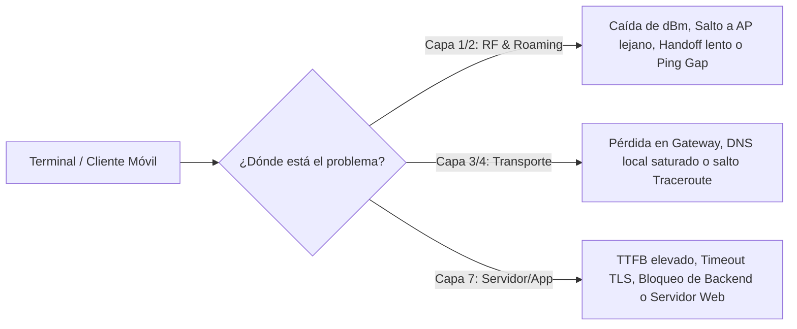
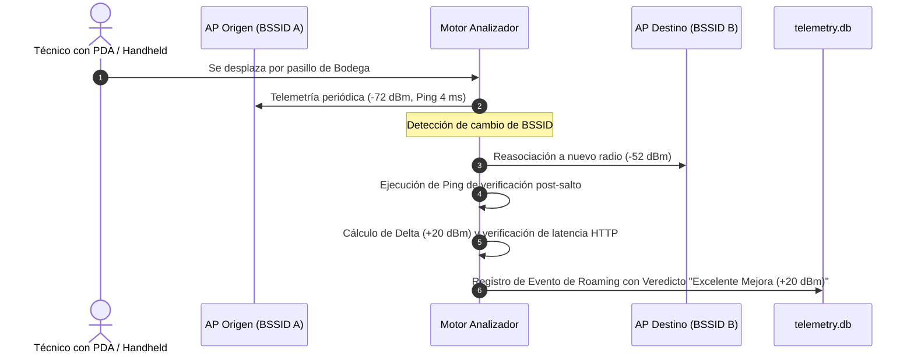
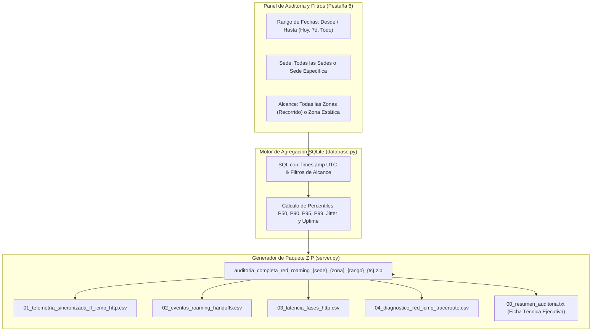

# 📶 Wi-Fi & Enterprise Application Telemetry Analyzer

> **Plataforma Integral de Diagnóstico de Red y Observabilidad de Aplicaciones en Tiempo Real**  
> *¿Congelamiento de terminales o lentitud operativa? Diagnóstico instantáneo: Capa 1/2 (Wi-Fi RF / Roaming) vs Capa 3/4 (Transporte / Red) vs Capa 7 (Servidor / Aplicación).*

[](https://www.python.org/)
[](requirements.txt)
[](#-arquitectura-100-offline-y-zero-pip-dependencies)
[](LICENSE)

---

## 📑 Tabla de Contenidos

1. [Visión General y Propósito](#-visión-general-y-propósito)
2. [Arquitectura General del Sistema](#-arquitectura-general-del-sistema)
3. [Funcionalidades Principales y Contexto Teórico](#-funcionalidades-principales-y-contexto-teórico)
   - [1. Telemetría Wi-Fi en Tiempo Real y Monitoreo RF](#1-telemetría-wi-fi-en-tiempo-real-y-monitoreo-rf)
   - [2. Análisis y Detección de Eventos de Roaming (Handoffs)](#2-análisis-y-detección-de-eventos-de-roaming-handoffs)
   - [3. Espectro Wi-Fi y Análisis de Canales (2.4 GHz, 5 GHz, 6 GHz, 7 GHz)](#3-espectro-wi-fi-y-análisis-de-canales-24-ghz-5-ghz-6-ghz-7-ghz)
   - [4. Sonda de Latencia HTTP de Alta Precisión por Fases (Capa 7)](#4-sonda-de-latencia-http-de-alta-precisión-por-fases-capa-7)
   - [5. Diagnóstico de Red ICMP y Traceroute Inteligente](#5-diagnóstico-de-red-icmp-y-traceroute-inteligente)
   - [6. Gestión Jerárquica de Sedes y Zonas (Walk-Tests y Zonas Estáticas)](#6-gestión-jerárquica-de-sedes-y-zonas-walk-tests-y-zonas-estáticas)
   - [7. Métricas Consolidadas, Percentiles y Paquete de Auditoría ZIP](#7-métricas-consolidadas-percentiles-y-paquete-de-auditoría-zip)
   - [8. Mapeo de Nombres de APs de Controladoras (Cisco, Aruba, UniFi)](#8-mapeo-de-nombres-de-aps-de-controladoras-cisco-aruba-unifi)
   - [9. Base de Datos IEEE OUI de Fabricantes y Actualización Oficial](#9-base-de-datos-ieee-oui-de-fabricantes-y-actualización-oficial)
   - [10. Parámetros de Configuración Centralizada y Autenticación Corporativa](#10-parámetros-de-configuración-centralizada-y-autenticación-corporativa)
4. [Estructura del Proyecto](#-estructura-del-proyecto)
5. [Instalación y Puesta en Marcha](#-instalación-y-puesta-en-marcha)
6. [Referencia Completa de la API REST](#-referencia-completa-de-la-api-rest)
7. [Herramientas de Línea de Comandos (CLI)](#-herramientas-de-línea-de-comandos-cli)
8. [Manual de Usuario para Soporte Nivel 1 (PDF)](#-manual-de-usuario-para-soporte-nivel-1-pdf)

---

## 🎯 Visión General y Propósito

En entornos empresariales críticos (**Centros de Distribución con WMS Manhattan/SAP**, **Puntos de Venta POS en Retail**, **Centros Hospitalarios** y **Oficinas Corporativas**), las terminales de radiofrecuencia (pistolas PDA, handhelds, lectores de código de barras y carretillas elevadoras) frecuentemente sufren desconexiones, pantallas congeladas o bloqueos intermitentes.

El personal operativo suele atribuir el problema a *"la señal Wi-Fi"*, mientras que los ingenieros de infraestructura sospechan de *"la aplicación o la base de datos"*.

**Wi-Fi & Enterprise Telemetry Analyzer** resuelve esta discrepancia de forma definitiva mediante telemetría simultánea y correlacionada:



---

## 🏛️ Arquitectura General del Sistema

El sistema está diseñado bajo un modelo modular de **Zero Pip Dependencies** (utiliza exclusivamente la biblioteca estándar de Python) y arquitectura **100% Offline-Ready** para funcionar en sitios de alta seguridad o áreas cerradas sin acceso a internet.

```mermaid
flowchart TD
    subgraph Frontend["Frontend SPA (HTML5 / Vanilla JS / CSS3)"]
        UI_Dash["Dashboard Telemetría Sincronizada (RF dBm, Ping, HTTP)"]
        UI_Roam["Tab 1: Historial de Roaming & Handoffs"]
        UI_Spec["Tab 2: Escáner de APs y Espectro (2.4/5/6/7 GHz)"]
        UI_HTTP["Tab 3: Fases de Latencia HTTP (DNS, TCP, TLS, TTFB)"]
        UI_Diag["Tab 4: Diagnóstico de Red (Traceroute & Multi-Ping)"]
        UI_Sedes["Tab 5: Sedes y Zonas (Catálogo Jerárquico)"]
        UI_Audit["Tab 6: Estadísticas & Auditoría (Percentiles & ZIP)"]
        UI_Config["Tab 7: Configuración, IEEE OUI & Nombres APs"]
    end

    subgraph Backend["Servidor Central (server.py)"]
        Router["HTTP Request Handler (puerto 8050)"]
        REST_API["API REST (/api/status, /api/oui, /api/export, etc.)"]
        State_Mgr["WiFiState (Gestor de Estado y Concurrencia con Locks)"]
    end

    subgraph Core["Motores Core de Medición (core/)"]
        M_Probe["probe.py (Sonda HTTP de 5 Fases con Sockets)"]
        M_Diag["net_diag.py (Gateway, Multi-Ping, Traceroute)"]
        M_Auth["ntlm_auth.py (Motor Criptográfico NTLMv1/v2 Nativo)"]
        M_AP["ap_manager.py (Mapeo BSSID / vBSSID a AP Name)"]
        M_OUI["oui_manager.py (Resolución Offline IEEE OUI)"]
    end

    subgraph Storage["Capa de Persistencia Relacional (database/)"]
        SQLite["SQLite WAL Mode (telemetry.db)"]
        T_Samples["telemetry_samples (Muestras Sincronizadas)"]
        T_Roam["roaming_events (Saltos entre APs)"]
        T_HTTP["http_probe_history (Fases de Latencia)"]
        T_Diag["net_diag_history (ICMP & Traceroute)"]
        T_Config["config (Configuración del Sistema)"]
        JSON_Catalog["data/sedes_zonas.json (Catálogo Maestro)"]
    end

    subgraph OS_Network["Capa de Red del Sistema Operativo (Linux)"]
        NL80211["nl80211 / iw / iwconfig (Estado Wi-Fi y Escaneo)"]
        IPRoute["ip route (Detección de Default Gateway)"]
        Resolv["/etc/resolv.conf (Servidores DNS del Sistema)"]
    end

    UI_Dash <--> REST_API
    UI_Roam <--> REST_API
    UI_Spec <--> REST_API
    UI_HTTP <--> REST_API
    UI_Diag <--> REST_API
    UI_Sedes <--> REST_API
    UI_Audit <--> REST_API
    UI_Config <--> REST_API

    Router --> REST_API
    REST_API <--> State_Mgr
    State_Mgr <--> M_Probe
    State_Mgr <--> M_Diag
    State_Mgr <--> M_AP
    State_Mgr <--> M_OUI

    M_Probe <--> M_Auth
    M_Probe --> SQLite
    M_Diag --> SQLite
    State_Mgr --> SQLite
    SQLite --> T_Samples
    SQLite --> T_Roam
    SQLite --> T_HTTP
    SQLite --> T_Diag
    SQLite --> T_Config
    JSON_Catalog <--> SQLite

    State_Mgr <--> NL80211
    M_Diag <--> IPRoute
    M_Diag <--> Resolv
```



---

## 🔬 Funcionalidades Principales y Contexto Teórico

### 1. Telemetría Wi-Fi en Tiempo Real y Monitoreo RF

#### 📚 Contexto Teórico:
La intensidad de señal recibida (**RSSI**, *Received Signal Strength Indicator*) se mide en **dBm** (decibelios relativos a 1 milivatio). Es una escala logarítmica donde cada incremento de 3 dB duplica la potencia de la señal:
- **-30 a -50 dBm:** Señal excepcional (muy cerca del AP).
- **-50 a -65 dBm:** Rango óptimo empresarial para datos de alta velocidad y voz/VoIP.
- **-67 dBm:** Umbral mínimo de diseño recomendado por Cisco/Aruba para roaming corporativo.
- **-70 a -75 dBm:** Cobertura límite; los clientes inician escaneos agresivos para cambiar de AP.
- **-80 dBm o menor:** Zona muerta o altamente susceptible a pérdidas de paquetes y desasociación.

#### ⚙️ Cómo Funciona:
El motor consulta la interfaz inalámbrica activa en Linux a través de `nl80211` (`iw dev <iface> link`) o herramientas de soporte (`iwconfig` / `nmcli`). Extrae en tiempo real:
- **BSSID y SSID:** Dirección física MAC del radio del AP y nombre de red.
- **Canal y Frecuencia Central:** Frecuencia exacta en MHz y canal asignado.
- **Banda Operativa:** Clasificación inmediata en 2.4 GHz, 5.0 GHz o 6.0 GHz.
- **Tasas de Transmisión (TX/RX Bitrate):** Modulación MCS, ancho de canal y número de flujos espaciales (NSS).
- **Ping Local a Puerta de Enlace:** Mide el retardo puro de la capa inalámbrica hacia el router/switch local.

---

### 2. Análisis y Detección de Eventos de Roaming (Handoffs)

#### 📚 Contexto Teórico:
El **roaming Wi-Fi** (o *handoff*) es el proceso mediante el cual un dispositivo cliente decide desconectarse de su Access Point actual y asociarse a otro AP con mejor señal o menor congestión dentro del mismo ESSID.
- **Roaming Proactivo / Eficiente:** El cliente detecta degradación (< -70 dBm) y cambia a un AP con ganancia positiva ($\Delta > 10 \text{ dBm}$) con una interrupción mínima.
- **Sticky Client (Cliente Pegajoso):** El dispositivo permanece atado a un AP lejano (-78 dBm) a pesar de estar físicamente debajo de un AP con -45 dBm, causando lentitud extrema.
- **Roaming Degradado / Ineficiente:** El cliente salta a un AP con igual o peor señal ($\Delta \le 0 \text{ dBm}$).
- **Ping Gap:** Lapso de milisegundos en el que la interfaz pierde conectividad de Capa 2 durante el reasociamiento y reautenticación 802.1X/WPA2-PSK.



#### ⚙️ Cómo Funciona:
El hilo supervisor compara en cada iteración el BSSID actual con el BSSID anterior. Si detecta un cambio:
1. Registra el instante exacto (`timestamp` Unix en UTC).
2. Captura la señal antes del salto (`prev_signal_dbm`) y la señal del nuevo AP (`new_signal_dbm`).
3. Calcula el $\Delta \text{ dBm} = \text{Señal Nueva} - \text{Señal Anterior}$.
4. Dispara un ciclo de diagnóstico de red inmediato para medir si hubo pérdida de paquetes en el salto.
5. Emite un **Veredicto Automático** clasificado en:
   - 🟢 **Excelente Mejora ($\ge +10 \text{ dBm}$)**
   - 🔵 **Mejora Aceptable ($+3 \text{ a } +9 \text{ dBm}$)**
   - 🟡 **Roaming Lateral / Neutro ($-2 \text{ a } +2 \text{ dBm}$)**
   - 🔴 **Roaming Degradado ($\le -3 \text{ dBm}$)**

---

### 3. Espectro Wi-Fi y Análisis de Canales (2.4 GHz, 5 GHz, 6 GHz, 7 GHz)

#### 📚 Contexto Teórico:
La interferencia en redes Wi-Fi proviene de dos fuentes:
- **Interferencia Co-Canal (CCI):** Varios APs transmitiendo en la misma frecuencia central compiten por el medio mediante CSMA/CA, causando retardo y encolamiento.
- **Interferencia de Canal Adyacente (ACI):** APs en canales solapados (típico en 2.4 GHz en canales que no sean 1, 6 u 11) degradan el SNR (*Signal-to-Noise Ratio*).
- **Anchos de Canal:** Canales de 20 MHz (máxima estabilidad en almacenes), 40 MHz, 80 MHz y 160 MHz (alta velocidad pero mayor susceptibilidad a interferencia).

```
   Banda 2.4 GHz (Canales No Solapados):
   [-- Canal 1 --]       [-- Canal 6 --]       [-- Canal 11 --]
     2412 MHz              2437 MHz              2462 MHz

   Banda 5 GHz (UNII-1, UNII-2, UNII-3):
   [Ch 36] [Ch 40] [Ch 44] [Ch 48] ... [Ch 149] [Ch 153] [Ch 157] [Ch 161]
```

#### ⚙️ Cómo Funciona:
El analizador activa un escaneo de fondo periódico (`iw dev scan` o `nmcli dev wifi`) y grafica en tiempo real un **diagrama parabólico de densidad espectral**:
- **Curvas de campana parabólica:** La altura de cada campana representa la intensidad RSSI en dBm; el ancho de la campana representa el ancho de canal (20, 40, 80 o 160 MHz).
- **Filtro Multi-Banda:** Selector para alternar instantáneamente entre **Todas las Bandas**, **2.4 GHz**, **5.0 GHz**, **6.0 GHz (Wi-Fi 6E)** y **7.0 GHz (Wi-Fi 7)**.
- **Resaltado del AP Conectado:** El radio activo se resalta con borde de alta luminosidad y etiquetas distintivas.
- **Tooltip Técnico Interactivo:** Al pasar el cursor sobre cualquier campana, se desglosa el SSID, BSSID, Nombre de AP corporativo, canal exacto, frecuencia en MHz, dBm y fabricante del hardware.

---

### 4. Sonda de Latencia HTTP de Alta Precisión por Fases (Capa 7)

#### 📚 Contexto Teórico:
Una solicitud HTTP/HTTPS hacia un servidor de aplicaciones transita por múltiples fases que deben aislarse para diagnosticar con certeza el origen de un retardo:

```mermaid
gantt
    title Desglose de Fases de Latencia HTTP (Capa 7)
    dateFormat X
    axisFormat %s ms
    section Fases de Conexión
    1. Resolución DNS          :done, 0, 15
    2. Handshake TCP (SYN/ACK) :active, 15, 45
    3. Negociación TLS / SSL   :crit, 45, 110
    4. Espera Servidor (TTFB)  :milestone, 110, 240
    5. Descarga de Contenido   :done, 240, 260
```



1. **Resolución DNS (`DNS Lookup`):** Tiempo en traducir el nombre de dominio a IP. Un valor alto (> 50 ms) delata servidores DNS locales mal configurados o saturados.
2. **Handshake TCP (`TCP Connect`):** Tiempo del saludo de 3 vías (`SYN -> SYN-ACK -> ACK`). Es el indicador puro del **Round Trip Time (RTT)** de la red física.
3. **Negociación TLS (`TLS Handshake`):** Intercambio criptográfico de certificados y claves simétricas. Requiere típicamente 1 o 2 RTTs adicionales y procesamiento de CPU.
4. **Time to First Byte (`TTFB`):** Tiempo transcurrido desde que se envía la petición HTTP hasta que llega el primer byte de respuesta. **Si el TTFB es alto pero el TCP es bajo, la lentitud es 100% interna del servidor web, microservicio, aplicación o base de datos.**
5. **Transferencia de Datos (`Content Transfer`):** Tiempo de lectura del payload completo por el socket.

#### ⚙️ Cómo Funciona:
Implementado en [core/probe.py](file:///home/cesarcely/Proyectos/wifi-roaming-analyzer/core/probe.py) utilizando **sockets puros de Python (`socket`, `ssl`)** sin librerías de alto nivel como `requests` o `urllib3` que enmascaran los tiempos intermedios:
- Mide con precisión de microsegundos (`time.perf_counter()`) cada transición.
- **Detección de Conexión Fría vs Reutilizada (`Cold vs Warm Total`):** Muestra el costo inicial de apertura contra el costo en estado estacionario.
- **Autenticación Corporativa Integrada:**
  - `Bearer Token` (para APIs REST y microservicios modernos).
  - `Basic Auth` (RFC 7617).
  - `NTLMv1 / NTLMv2` nativo implementado con criptografía pura (DES, MD4, HMAC-MD5) sin requerir `pywinrm` ni librerías externas.

---

### 5. Diagnóstico de Red ICMP y Traceroute Inteligente

#### 📚 Contexto Teórico:
- **Default Gateway (Puerta de Enlace):** El primer salto hacia la infraestructura cableada. Un ping alto hacia el gateway mientras la señal Wi-Fi es buena delata sobrecarga en el AP o saturación del switch de acceso.
- **Traceroute (TTL Incremental):** Utiliza paquetes con Time-to-Live progresivo ($TTL = 1, 2, 3\dots$) para provocar mensajes ICMP `Time Exceeded` e identificar en qué salto geográfico o router intermedio se dispara la latencia o se descartan paquetes.
- **Jitter (RFC 3550):** Variación estadística del retardo entre paquetes consecutivos:
  $$J = J_{prev} + \frac{|D(i, i-1)| - J_{prev}}{16}$$
  Un jitter alto (> 15 ms) provoca degradación severa en lectores inalámbricos y terminales de voz.


#### ⚙️ Cómo Funciona ([core/net_diag.py](file:///home/cesarcely/Proyectos/wifi-roaming-analyzer/core/net_diag.py)):
- **Detección Automática de Gateway:** Analiza las tablas de enrutamiento (`ip route show default` o `route -n`) de forma no intrusiva.
- **Detección de Servidores DNS Locales:** Extrae los resolvers primarios y secundarios de `/etc/resolv.conf`.
- **Multi-Ping Concurrente:** Envía ráfagas sincronizadas al Gateway, a los servidores DNS locales y al Host objetivo de la aplicación.
- **Traceroute Integrado:** Diagnostica hasta 30 saltos con detección de nombres DNS inversos y retardo individual.

---

### 6. Gestión Jerárquica de Sedes y Zonas (Walk-Tests y Zonas Estáticas)

#### 📚 Contexto Teórico:
Las pruebas de rendimiento inalámbrico se dividen operativamente en dos metodologías:
1. **Prueba Estática en Zona Crítica:** El técnico ubica el equipo en un punto fijo de alta fricción (ej. *Caja 1*, *Muelle 8*, *Rack 12-13*) para evaluar estabilidad durante 30 a 60 minutos.
2. **Prueba en Movimiento (Walk-Test / Recorrido Completo):** El técnico camina a velocidad normal atravesando pasillos, racks y áreas de despacho para forzar saltos entre APs e identificar zonas de sombra, solapamiento insuficiente o pérdida de sesión.

#### ⚙️ Cómo Funciona:
- **Catálogo Maestro JSON ([data/sedes_zonas.json](file:///home/cesarcely/Proyectos/wifi-roaming-analyzer/data/sedes_zonas.json)):** Estructura jerárquica de sedes físicas (`Tienda_Principal`, `Bodega_CLEN`, `Oficina_Av68`) con sus respectivas zonas operativas.
- **Sincronización Limpia (`Recargar sedes_zonas.json`):** Al recargar, el sistema reemplaza fielmente el catálogo activo desde el archivo en disco, evitando que zonas antiguas o renombradas se mezclen con el catálogo nuevo.
- **Gestión Directa en la Interfaz (Pestaña 5):**
  - Creación de nuevas sedes y zonas.
  - Contador visual en vivo de zonas asignadas (ej. `25 zonas`).
  - Eliminación individual de zonas mediante botón interactivo `×`.
  - Importación y exportación de respaldos en formatos JSON y CSV.

---

### 7. Métricas Consolidadas, Percentiles y Paquete de Auditoría ZIP

#### 📚 Contexto Teórico:
En redes de computadores, el **promedio aritmético oculta los incidentes**: si 99 solicitudes tardan 50 ms y 1 tarda 5000 ms, el promedio es 99.5 ms (aparentemente "normal"), pero el usuario experimentó una congelación severa.
Los **percentiles** revelan la experiencia real del usuario:
- **$P_{50}$ (Mediana):** Comportamiento del 50% de las solicitudes normales.
- **$P_{90}$ y $P_{95}$:** Rendimiento bajo condiciones de carga o micro-interferencias.
- **$P_{99}$:** El peor 1% de las transacciones; captura con exactitud los congelamientos de pantalla y cortes de sesión.



#### 📦 Estructura del Paquete ZIP de Auditoría:
Al pulsar **`Exportar Todo (.ZIP)`**, el servidor compila en memoria un paquete de auditoría que incluye:
1. `01_telemetria_sincronizada_rf_icmp_http.csv`: Registro exhaustivo de cada segundo con dBm, canal, banda, ping y fases HTTP.
2. `02_eventos_roaming_handoffs.csv`: Historial de saltos entre APs con MACs, nombres de AP, deltas y veredictos.
3. `03_latencia_fases_http.csv`: Tiempos discriminados de DNS, TCP, TLS, TTFB y Transferencia.
4. `04_diagnostico_red_icmp_traceroute.csv`: Registros de pruebas multi-ping y saltos de traceroute.
5. `00_resumen_auditoria.txt`: Ficha técnica ejecutiva con metadata de la prueba (fecha/hora, sede, alcance de recorrido, percentiles calculados y uptime).

#### 🧹 Limpieza y Reinicio de la Base de Datos (`Limpiar BD`):
- **Botón `Limpiar BD` en la Barra de Herramientas:** Permite vaciar con confirmación de seguridad todos los registros acumulados en la base de datos relacional (`telemetry_samples`, `roaming_events`, `http_probe_history` y `net_diag_history`) antes de iniciar una nueva jornada de pruebas o walk-test.
- **Opción en Menú Desplegable:** Accesible también desde el menú *Opciones CSV* mediante la acción rápida `Limpiar Base de Datos`.
- **Integridad Garantizada:** Preserva intactos los parámetros de configuración, el catálogo maestro de sedes/zonas y el inventario de nombres de APs.
- **Compactación SQLite WAL:** Ejecuta un checkpoint con truncado (`PRAGMA wal_checkpoint(TRUNCATE)`) para recuperar espacio físico en disco de forma instantánea.

---

### 8. Mapeo de Nombres de APs de Controladoras (Cisco, Aruba, UniFi)

#### 📚 Contexto Teórico:
Las controladoras de red asignan nombres nemotécnicos a cada AP (`AP-Bodega-Norte-01`), pero las tramas de radio 802.11 únicamente transmiten el **BSSID (MAC física)**.
Adicionalmente, un único AP físico que emite múltiples redes emite **BSSIDs virtuales (vBSSID / MBSSID)** que difieren en los últimos bits o en el primer octeto.

#### ⚙️ Cómo Funciona ([core/ap_manager.py](file:///home/cesarcely/Proyectos/wifi-roaming-analyzer/core/ap_manager.py)):
- Normaliza automáticamente cualquier formato de MAC (`00:11:22:33:44:55`, `00-11-22-33-44-55`, `0011.2233.4455`).
- **Resolución por Máscara de Prefijo:** Si la controladora exportó la MAC base ethernet del AP, el analizador detecta las coincidencias de los vBSSIDs correspondientes.
- Permite importar inventarios masivos desde archivos CSV exportados de Cisco Catalyst Center, Aruba Central, UniFi Controller, Huawei iMaster NCE o FortiGate.
- Muestra el nombre asignado en la cabecera del dashboard, en el historial de roaming y en el escáner de espectro.

---

### 9. Base de Datos IEEE OUI de Fabricantes y Actualización Oficial

#### 📚 Contexto Teórico:
Las direcciones de control de acceso al medio (**MAC / EUI-48**) son identificadores físicos de 48 bits (6 octetos) representados convencionalmente en notación hexadecimal (`XX:XX:XX:XX:XX:XX` o `XX-XX-XX-XX-XX-XX`).

El estándar IEEE 802 divide la estructura de una dirección MAC en dos segmentos fundamentales de 24 bits cada uno:

```
       ┌───────────────────────────────┬───────────────────────────────┐
       │   OUI (IEEE Manufacturer)     │    NIC / Radio Identifier     │
       │           24 bits             │            24 bits            │
       └───────────────────────────────┴───────────────────────────────┘
         Octeto 1   Octeto 2   Octeto 3   Octeto 4   Octeto 5   Octeto 6
        [  00   :     0B   :     86  ] : [  12   :     34   :     56  ]
                         ▲
                         └─ Asignado a: Aruba Networks / HPE
```

1. **OUI (Organizationally Unique Identifier):** Los primeros 24 bits (3 octetos) son asignados exclusivamente por la **IEEE Registration Authority** a cada fabricante de hardware (*MA-L: MAC Address Large Registry*).
   - Bit 0 del primer octeto: **I/G (Individual / Group):** `0` = Unicast, `1` = Multicast/Broadcast.
   - Bit 1 del primer octeto: **U/L (Universal / Local):** `0` = Globalmente único (asignado oficialmente por IEEE), `1` = Administrado localmente (dirección privada/aleatorizada generada por smartphones o sistemas operativos modernos).
2. **NIC Specific / Device Identifier:** Los 24 bits restantes (3 octetos) son administrados internamente por el fabricante para numerar de manera unívoca cada tarjeta de red, interfaz física o radio virtual (vBSSID).

En entornos de auditoría y troubleshooting de radiofrecuencia, la resolución OUI en tiempo real ofrece ventajas operativas críticas:
- **Detección de Rogue APs (Puntos de Acceso Piratas):** Identifica de inmediato si un AP emitiendo el SSID corporativo pertenece a la marca homologada (ej. Cisco, Aruba, Ruckus) o si es un router doméstico o hotspot no autorizado (ej. TP-Link, Xiaomi, Tenda).
- **Correlación de Fallas de Roaming por Hardware:** Permite diagnosticar si ciertos saltos problemáticos ocurren consistentemente al conectar con APs de un lote o fabricante específico.
- **Auditoría Física y Mapeo en Sitio:** Ayuda a los ingenieros de campo a localizar rápidamente equipos físicos en techos o bandejas portacables.

#### ⚙️ Cómo Funciona ([core/oui_manager.py](file:///home/cesarcely/Proyectos/wifi-roaming-analyzer/core/oui_manager.py)):
- **Base de Datos Local Offline:** Incluye un archivo precompilado en [data/oui_vendors.json](file:///home/cesarcely/Proyectos/wifi-roaming-analyzer/data/oui_vendors.json) con **más de 40,395 fabricantes registrados** por el IEEE, operando al 100% en entornos air-gapped o sin acceso a Internet.
- **Normalización de Formatos MAC:** Acepta indistintamente delimitadores de dos puntos (`00:1A:2B`), guiones (`00-1A-2B`), puntos tipo Cisco (`001A.2B`) o cadenas continuas (`001A2B`).
- **Gestión Visual Centralizada (Pestaña 7 - "Configuración"):**
  - **Métricas Visuales en Vivo:** Tarjetas resumen de *Total Fabricantes*, *Personalizados* y *Fecha de Última Sincronización*.
  - **Sincronización en 1 Clic con el IEEE (`Actualizar desde IEEE`):** Descarga en segundo plano el registro oficial MA-L (`standards-oui.ieee.org`), procesa el archivo CSV e incorpora las nuevas asignaciones sin reiniciar el servidor.
  - **Banner Dinámico de Progreso:** Alerta visual en tiempo real que reporta los estados de avance (`Conectando`, `Descargando`, `Procesando`, `Completado`).
  - **Búsqueda Instantánea con Debounce:** Cuadro de búsqueda reactivo con retardo de 300 ms para consultar inmediatamente por prefijo MAC o por nombre comercial del fabricante.
  - **Registro de Prefijos Personalizados (Custom Overrides):** Permite registrar prefijos o modelos particulares de laboratorio (ej. `00:1A:1E` $\to$ `Cisco Catalyst Lab 9130`). Estos registros tienen prioridad absoluta y **se conservan íntegros ante cualquier actualización oficial del IEEE**.
  - **Eliminación Rápida:** Botón de papelera en la tabla para remover personalizaciones en un clic.
- **Herramienta de Consola (CLI):** Sincronizable y consultable también desde terminal mediante [scripts/update_oui.py](file:///home/cesarcely/Proyectos/wifi-roaming-analyzer/scripts/update_oui.py).

---

### 10. Parámetros de Configuración Centralizada y Autenticación Corporativa

#### 📚 Contexto Teórico:
Las aplicaciones empresariales de misión crítica (como **SAP Fiori**, **Oracle WMS**, **Manhattan SCALE** o **Microsoft SharePoint**) típicamente implementan mecanismos robustos de control de acceso en Capa 7 (Aplicación).

Para evaluar con fidelidad la latencia y disponibilidad real que experimenta un usuario o terminal móvil, la sonda de diagnóstico debe autenticarse de forma transparente y legítima frente al servidor web o gateway corporativo:
- **NTLM (NT LAN Manager) v1 y v2:** Protocolo propietario de Microsoft basado en un desafío/respuesta (*Challenge-Response*) de tres vías con funciones hash criptográficas DES, MD4 y HMAC-MD5. Es el estándar obligatorio en portales corporativos basados en IIS y SharePoint con integración a Active Directory.
- **Basic Authentication (RFC 7617):** Esquema donde las credenciales de usuario y contraseña se transmiten en Base64 bajo el encabezado HTTP estándar `Authorization: Basic <credentials>`.
- **Bearer Tokens / OAuth2 (RFC 6750):** Mecanismo utilizado por arquitecturas modernas de microservicios y APIs REST, donde la autorización se concede mediante un token criptográfico o JWT en el encabezado `Authorization: Bearer <token>`.

#### ⚙️ Cómo Funciona (Pestaña 7 - "Configuración"):
La pestaña **Configuración** consolida en un único panel de control todas las variables de operación del sistema:

1. **Card 1: Selección de Interfaz de Red Wi-Fi:**
   - Detecta automáticamente todas las interfaces inalámbricas activas en Linux (`wlan0`, `wlan1`, `wlp3s0`).
   - Permite conmutar la interfaz monitoreada en caliente sin necesidad de reiniciar el servicio ni interrumpir la captura.
2. **Card 2: Parámetros del Motor de Telemetría:**
   - *Intervalo de Muestreo:* Frecuencia de escaneo y consulta de radiofrecuencia (por defecto 5 segundos).
   - *Timeout de Sonda:* Tiempo máximo de espera para peticiones HTTP antes de declarar falla.
   - *Verificación SSL:* Permite deshabilitar la validación de certificados para entornos de prueba con certificados autofirmados o de CA interna.
   - *Destinos Adicionales de Ping:* Direcciones IP o nombres de host adicionales (ej. base de datos o controlador de dominio) separados por comas.
   - *Diagnóstico Periódico de Red:* Frecuencia en minutos para disparar automáticamente pruebas de Traceroute y Multi-ping.
   - *Pausa y Reanudación de Captura:* Selector que permite pausar temporalmente la ingesta de telemetría sin perder la configuración activa.
3. **Card 3: Inventario y Mapeo de Nombres de APs:**
   - Asignación manual de nombres nemotécnicos de AP a BSSIDs físicos o virtuales.
   - **Importador CSV Inteligente:** Parser capaz de interpretar exportaciones de Cisco Catalyst Center, Aruba Central/AirWave, FortiGate y UniFi.
   - Exportación de respaldo en formato CSV y botón de limpieza total con diálogo de confirmación.
4. **Card 4: Base de Datos de Fabricantes IEEE OUI:**
   - Panel de control completo para consulta, búsqueda reactiva, registro de fabricantes propios y sincronización en 1 clic con el registro de la IEEE.
5. **Card 5: Autenticación Empresarial (Capa 7):**
   - Selector dinámico de esquema: `NTLMv1/v2`, `Basic Auth` o `Bearer Token`.
   - Campos configurables de Dominio, Usuario, Contraseña y Token con revelador visual interactivo (`eye toggle`).
   - **Motor Criptográfico NTLM Nativo ([core/ntlm_auth.py](file:///home/cesarcely/Proyectos/wifi-roaming-analyzer/core/ntlm_auth.py)):** Implementa el handshake NTLMv2 completo (`Type 1 Negotiation` $\to$ `Type 2 Challenge` $\to$ `Type 3 Authentication`) utilizando sockets y la biblioteca estándar de Python sin requerir librerías externas.
   - **Botón `Probar Credenciales Ahora`:** Ejecuta una sonda HTTP inmediata contra la URL de destino (`POST /api/probe/now`) y despliega al instante el código de respuesta HTTP obtenido (ej. `200 OK`, `401 Unauthorized`), la latencia total y cualquier error devuelto por el servidor, validando las credenciales antes de iniciar recorridos en sitio.

---

## 📁 Estructura del Proyecto

```
wifi-roaming-analyzer/
├── core/                        # Motores de telemetría y diagnóstico
│   ├── probe.py                 # Sonda HTTP de 5 fases (sockets puros)
│   ├── net_diag.py              # Diagnóstico ICMP, Gateway, DNS y Traceroute
│   ├── ntlm_auth.py             # Motor criptográfico NTLMv1/v2 nativo
│   ├── ap_manager.py            # Resolución y mapeo de nombres de APs
│   └── oui_manager.py           # Base de datos y resolución IEEE OUI
├── database/                    # Capa de persistencia SQLite
│   ├── database.py              # Modelos relacionales, percentiles y exportaciones
│   └── telemetry.db             # Base SQLite WAL (generada automáticamente)
├── data/                        # Archivos de datos y catálogos maestros
│   ├── sedes_zonas.json         # Catálogo maestro de Sedes y Zonas
│   ├── ap_names.json            # Mapeo activo BSSID -> Nombre de AP
│   ├── ap_names.example.json    # Plantilla de ejemplo de inventario de APs
│   ├── oui_vendors.json         # Base de datos de fabricantes IEEE OUI
│   └── roaming_history.json     # Historial JSON de respaldo
├── docs/                        # Documentación operativa y manuales de usuario
│   ├── manual_soporte_nivel1.html # Plantilla maquetada con soporte de impresión
│   └── Manual_Usuario_Soporte_Nivel_1.pdf # Manual de usuario PDF oficial
├── scripts/                     # Herramientas de soporte y CLI
│   ├── manage_aps.py            # CLI para consulta y gestión de APs
│   ├── update_oui.py            # CLI para sincronizar con el IEEE OUI Registry
│   └── install-dependencies.sh  # Instalador de utilidades de red Linux
├── static/                      # Frontend SPA (100% Offline)
│   ├── index.html               # Estructura del dashboard y pestañas
│   ├── app.js                   # Lógica de renderizado, gráficos y eventos
│   ├── styles.css               # Diseño moderno, contrastes e iconografía
│   ├── chart.umd.min.js         # Motor de gráficos Chart.js local
│   └── Manual_Usuario_Soporte_Nivel_1.pdf # Descargable web directo
├── server.py                    # Entrypoint principal y servidor HTTP/REST
├── run.sh / run.bat / run.ps1   # Scripts de inicio rápido multiplataforma
├── stop.sh / stop.bat           # Scripts de detención limpia del servidor
├── requirements.txt             # Dependencias Python (0 dependencias externas)
├── requirements-system.txt      # Paquetes del sistema operativo (Linux)
├── Manual_Usuario_Soporte_Nivel_1.pdf # Manual de usuario en raíz
└── README.md                    # Documentación técnica completa
```

---

## 🚀 Instalación y Puesta en Marcha

### Prerrequisitos del Sistema (Linux / Debian / Ubuntu / Raspberry Pi OS):
```bash
# Actualizar repositorios e instalar utilidades de red
sudo apt-get update
sudo apt-get install -y python3 iw wireless-tools iproute2 iputils-ping
```

### Iniciar el Servidor:
```bash
# Otorgar permisos de ejecución (primera vez)
chmod +x run.sh stop.sh

# Iniciar el analizador
./run.sh
```

El servidor iniciará automáticamente en `http://localhost:8050`. Abre cualquier navegador web (Chrome, Firefox, Edge) para interactuar con la plataforma.

### Opciones de Inicio Avanzadas:
```bash
# Iniciar en un puerto específico
./run.sh --port 9000

# Especificar la interfaz inalámbrica de forma manual
./run.sh -i wlan0

# Listar interfaces Wi-Fi detectadas por el sistema
python3 server.py --list
```

### Detener el Servidor:
```bash
./stop.sh
```

---

## 📡 Referencia Completa de la API REST

### Endpoints de Monitoreo y Estado (GET):

| Endpoint | Parámetros Query | Descripción |
| :--- | :--- | :--- |
| `GET /api/status` | - | Estado en tiempo real del AP conectado, RSSI (dBm), canal, bitrates, ping y última sonda HTTP. |
| `GET /api/scan` | - | Lista de todos los APs vecinos detectados con BSSID, SSID, dBm, canal, banda y fabricante OUI. |
| `GET /api/interfaces` | - | Interfaces Wi-Fi detectadas por el sistema operativo y la interfaz activa monitoreada. |
| `GET /api/stats` | `location`, `zone`, `start_date`, `end_date` | Estadísticas acumuladas, percentiles ($P_{50}, P_{90}, P_{95}, P_{99}$), jitter y uptime de sesión. |
| `GET /api/history` | `limit`, `location`, `zone` | Muestras recientes de telemetría de radiofrecuencia, ping y HTTP. |
| `GET /api/roaming-history`| `limit`, `location`, `zone` | Registro cronológico de eventos de roaming (handoffs) y veredictos de calidad. |
| `GET /api/http-phases/history`| `limit`, `location`, `zone` | Historial de latencia HTTP desglosada por fases (DNS, TCP, TLS, TTFB, Transfer). |
| `GET /api/net-diag` | - | Caché del último diagnóstico de Gateway, servidores DNS locales e historial de Traceroute. |
| `GET /api/locations` | `configured_only`, `only_data` | Listado jerárquico de sedes disponibles para auditoría o configuración. |
| `GET /api/zones` | - | Mapeo relacional de Sedes a Zonas configuradas. |
| `GET /api/oui` | - | Resumen general de la base de datos de fabricantes OUI (total, personalizados, fecha de actualización). |
| `GET /api/oui/search` | `q`, `limit` | Búsqueda reactiva de fabricantes por prefijo MAC (ej: `00:1A:2B`) o nombre (`Cisco`, `Aruba`, etc.). |
| `GET /api/oui/status` | - | Estado en tiempo real del proceso de sincronización con la IEEE (`idle`, `downloading`, `processing`, `completed`). |
| `GET /api/ap-names` | `q`, `limit` | Inventario de nombres de APs registrados (BSSID, nombre asignado, ubicación y modelo). |
| `GET /api/presets` | - | Listado de presets de configuración rápida predefinidos (Manhattan WMS, SAP GUI, Retail POS, etc.). |
| `GET /api/export` | `type`, `format`, `location`, `zone`, `start_date`, `end_date` | Genera y descarga informes individuales CSV o el paquete consolidado `.ZIP`. |

### Endpoints de Control y Configuración (POST):

| Endpoint | Payload JSON | Descripción |
| :--- | :--- | :--- |
| `POST /api/config` | `{ "target_url": "...", "probe_interval_seconds": 5, ... }` | Actualiza la configuración global del motor de telemetría y autenticación. |
| `POST /api/probe/now` | `{}` | Dispara una sonda HTTP inmediata para validar en caliente la conexión y las credenciales corporativas. |
| `POST /api/trigger-test-ping` | `{}` | Ejecuta una ráfaga de pings de prueba hacia el gateway para evaluar estabilidad y pérdida de paquetes. |
| `POST /api/locations/sync` | `{}` | Recarga limpiamente el catálogo maestro desde `data/sedes_zonas.json` reemplazando zonas en memoria. |
| `POST /api/locations/delete`| `{ "location": "Nombre_Sede" }` | Elimina una sede de la configuración activa. |
| `POST /api/zones` | `{ "location": "Sede", "zone": "Nueva_Zona" }` | Registra una nueva zona operativa en la sede indicada. |
| `POST /api/zones/delete` | `{ "location": "Sede", "zone": "Zona" }` | Elimina una zona específica de la sede indicada. |
| `POST /api/net-diag/run` | `{}` | Dispara un diagnóstico de red en tiempo real (Multi-ping y Traceroute). |
| `POST /api/oui/update` | `{}` | Inicia la descarga y compilación del registro oficial de fabricantes del IEEE en segundo plano. |
| `POST /api/oui/add` | `{ "prefix": "00:1A:1E", "vendor": "Nombre" }` | Registra o actualiza un prefijo OUI personalizado con persistencia garantizada. |
| `POST /api/oui/remove` | `{ "prefix": "00:1A:1E" }` | Elimina un prefijo OUI personalizado. |
| `POST /api/ap-names/add` | `{ "bssid": "...", "name": "...", "location": "...", "model": "..." }` | Registra o actualiza un Access Point en el inventario. |
| `POST /api/ap-names/remove` | `{ "bssid": "..." }` | Elimina un Access Point del inventario. |
| `POST /api/ap-names/import-csv` | `{ "csv_content": "..." }` | Importación masiva de inventario de APs desde archivo CSV. |
| `POST /api/ap-names/clear` | `{}` | Elimina todos los Access Points registrados en el inventario. |
| `POST /api/clear` | `{ "scope": "all" \| "telemetry" \| "roaming" }` | Limpia los historiales de la base de datos según el alcance seleccionado. |
| `POST /api/set-interface` | `{ "interface": "wlan0" }` | Cambia en caliente la interfaz inalámbrica monitoreada sin reiniciar. |

---

## 💻 Herramientas de Línea de Comandos (CLI)

### 1. Gestor de Nombres de APs ([scripts/manage_aps.py](file:///home/cesarcely/Proyectos/wifi-roaming-analyzer/scripts/manage_aps.py)):
Permite administrar el inventario de Access Points desde terminal o scripts de automatización:
```bash
# Listar todos los APs registrados en el inventario
python3 scripts/manage_aps.py --list

# Buscar un AP por nombre o ubicación
python3 scripts/manage_aps.py --search "Bodega Norte"

# Consultar un AP por dirección MAC / BSSID
python3 scripts/manage_aps.py --lookup 00:11:22:33:44:55

# Registrar o actualizar un AP manualmente
python3 scripts/manage_aps.py --add "00:11:22:33:44:55" "AP-Muelle-01" --location "Bodega CLEN" --model "Cisco 9120"

# Importar inventario masivo desde archivo CSV
python3 scripts/manage_aps.py --import-csv data/mis_aps_cisco.csv
```

### 2. Actualizador de Fabricantes IEEE OUI ([scripts/update_oui.py](file:///home/cesarcely/Proyectos/wifi-roaming-analyzer/scripts/update_oui.py)):
Permite consultar y mantener actualizada la base de datos de fabricantes OUI con los estándares oficiales del IEEE:
```bash
# Sincronizar y compilar la base de datos oficial del IEEE
python3 scripts/update_oui.py

# Ver estadísticas actuales del catálogo OUI
python3 scripts/update_oui.py --stats

# Consultar el fabricante de una dirección MAC
python3 scripts/update_oui.py --lookup 00:0B:86:12:34:56

# Añadir un fabricante o router de laboratorio personalizado
python3 scripts/update_oui.py --add "00:1A:1E" "Cisco Catalyst Lab"
```

---

## 📘 Manual de Usuario para Soporte Nivel 1 (PDF)

El proyecto incluye un manual completo de 5 páginas en formato PDF especialmente redactado en lenguaje sencillo y amigable para el equipo de **Mesa de Ayuda, Helpdesk y Técnicos de Soporte Nivel 1**:

- **Ruta del archivo local:** [Manual_Usuario_Soporte_Nivel_1.pdf](file:///home/cesarcely/Proyectos/wifi-roaming-analyzer/Manual_Usuario_Soporte_Nivel_1.pdf)
- **Acceso web en vivo:** En la cabecera del dashboard mediante el botón `Manual PDF` o navegando a `http://localhost:8050/Manual_Usuario_Soporte_Nivel_1.pdf`.
- **Plantilla de maquetación HTML:** [docs/manual_soporte_nivel1.html](file:///home/cesarcely/Proyectos/wifi-roaming-analyzer/docs/manual_soporte_nivel1.html)

### Contenido del Manual:
1. **¿Qué es la herramienta y para qué sirve?** Diferenciación rápida de fallas (Wi-Fi vs Router vs Servidor/Aplicación).
2. **Cómo iniciar y seleccionar la Sede/Zona** en la interfaz web.
3. **El Semáforo de Señal Wi-Fi:** Tabla comparativa de valores dBm (-30 a -90) y latencia de Ping en ms.
4. **Pruebas de Movimiento (Walk-Test / Roaming):** Cómo detectar clientes pegajosos (*Sticky Clients*) y evaluar saltos entre antenas.
5. **¿Por qué la aplicación está lenta?** Guía para interpretar las fases HTTP (DNS, TCP, TLS, TTFB) y saber con exactitud a quién escalar.
6. **Generar Evidencia y Limpiar la Base de Datos:** Pasos para exportar el paquete `.ZIP` y vaciar registros con el botón `Limpiar BD`.
7. **Configuración Rápida:** Conmutar antenas Wi-Fi y probar credenciales en 1 clic.
8. **Guía de Solución Rápida (Cheat-Sheet):** Matriz de síntomas reportados por el usuario vs causa real y glosario técnico esencial para Nivel 1.

---

## 📄 Licencia

Este proyecto está distribuido bajo la licencia **MIT**. Eres libre de utilizarlo, modificarlo y desplegarlo en entornos comerciales, corporativos o educativos.
